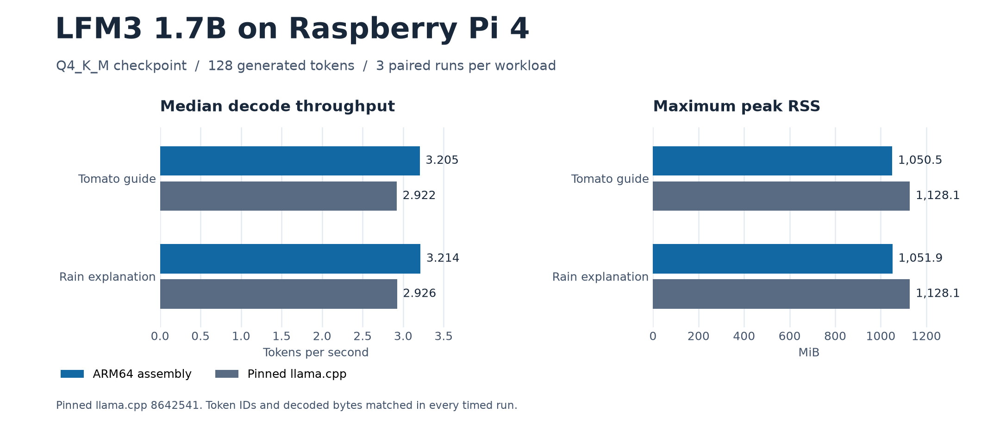

# LFM3 1.7B in ARM64 assembly on Raspberry Pi 4

I used Codex to write an inference engine in ARM64 assembly as a Raspberry Pi 4 hobby experiment. It runs one checkpoint, Liquid AI's LFM3-1.7B Q4_K_M. I used autoresearch to test changes on the physical board, with greedy output checks alongside the full inference benchmarks.

The model loader, tokenizer, inference graph, worker pool, greedy selection, and output path are written in AArch64 assembly. The runtime calls libc, libm, and POSIX services. Python prepares the checkpoint index and auxiliary tables offline.

## Measured on a physical Pi 4

| Workload | Decode tok/s, assembly / llama.cpp | Peak RSS, assembly / llama.cpp | Median first token, assembly / llama.cpp |
| --- | ---: | ---: | ---: |
| Tomato growing guide | 3.205 / 2.922 | 1,050.5 / 1,128.1 MiB | 3.74 / 4.41 s |
| Rain explanation | 3.214 / 2.926 | 1,051.9 / 1,128.1 MiB | 3.81 / 4.34 s |

Decode improved 9.67% and 9.84% across the two workloads. The ranges from three paired runs per workload separated. Each timed continuation matched the reference token IDs and decoded bytes. A separate six-prompt correctness corpus matched all 768 generated greedy IDs and decoded bytes, with three prompts extending beyond the 256-token sliding window.

The baseline is llama.cpp [8642541](https://github.com/ggml-org/llama.cpp/commit/8642541b255bfb5dc39cd351a178be09013a55d6). Both engines used the same checkpoint, four prefill workers, three decode workers, serial prefill, a 512-token context, FP32 KV, flash attention off, and warm model file pages. Decode rate counts the 127 evaluations after the first token. Peak RSS is the largest process high-water mark across the three timed runs for each engine. Full process rates, first token latency, and decode rates are recorded separately.



[Individual runs](benchmarks/historical-timings.csv) · [Protocol](benchmarks/protocol.json) · [Greedy parity](benchmarks/greedy-parity.json) · [Measured source and binary hashes](benchmarks/source-provenance.json)

## Build and run

Use 64-bit Raspberry Pi OS on a Pi 4 with GCC, make, Python 3.11 or later, and NumPy for offline preparation. The Linux runtime uses NEON and CRC32.

Obtain the [original Liquid AI GGUF](https://huggingface.co/LiquidAI/LFM3-1.7B-GGUF), revision `b3f2ae5d73cd3c91bf40e8ba752c648aa05dffdf`, file `LFM3-1.7B-Q4_K_M.gguf`. Both preparation tools bind to this exact SHA-256:

```text
3793e1e6e2266919d6e015287221b41100175a98eddaba92e111aed3b05c93c4
```

From the repository root:

```sh
checkpoint=/absolute/path/to/LFM3-1.7B-Q4_K_M.gguf
sha256sum "$checkpoint"
python3 tools/prepare.py "$checkpoint"
python3 tools/pack_coarse_vocab.py "$checkpoint"
make -j2

LFM_Q8=1 LFM_THREADS=4 LFM_DECODE_THREADS=3 LFM_SPEC=0 LFM_REPORT=1 \
LFM_COARSE="$PWD/build/h34-coarse-v1/coarse-output.bin" \
LFM_RESIDUAL="$PWD/build/h34-coarse-v1/residual-norms.f32" \
  ./build/lfm3-pi4 "$checkpoint" 'Explain how rain forms.' 32
```

The packing step needs a fresh output directory. It creates 153.6 MB of auxiliary head data locally. Both auxiliary paths and the explicit environment above select the measured execution mode. Ordinary generation stops at EOS. The trace executable is for benchmarking and writes binary token IDs to file descriptor 4.

This runtime supports one greedy sequence within the 512-token context, including prompt and generated tokens. It binds the loader to this checkpoint's tensor layout and CRC. The optimized output path uses a compact vocabulary scan and conservative bounds, then scores candidates against their original Q6 rows. Original weights stay in the GGUF. [Vocabulary scoring diagram](benchmarks/greedy-head-flow.png)

## Reproduce the comparison

Install CMake, Git, a C++ compiler, and Raspberry Pi OS's `vcgencmd` utility. From the repository root:

```sh
git clone https://github.com/ggml-org/llama.cpp.git
git -C llama.cpp checkout --detach 8642541b255bfb5dc39cd351a178be09013a55d6
cmake -S native-benchmark -B build/llama \
  -DLLAMA_SOURCE="$PWD/llama.cpp" -DCMAKE_BUILD_TYPE=Release
cmake --build build/llama --target latency-llama -j2
python3 tools/reproduce.py --model "$checkpoint"
```

The runner uses two prompts, one warmup per engine per prompt, then three alternating pairs with 128 generated tokens per run. It checks the decoded text and token IDs against the archived canonical hashes and writes a report and raw measurements under `results/reproduction/`. Run on an idle board with at least 1.5 GiB available before each comparison. The adapter links the pinned llama.cpp core and uses its public C API.

The published measurements identify the original binaries by hash. A local rebuild records its own hashes and must pass output checks before its timing is comparable. Use the resulting report for that board, OS, compiler, and thermal state.

## Provenance

This export keeps the source files used by the measured H42 build and a small public benchmark entry point. The original engine code is [MIT licensed](LICENSE). See [third-party notices](NOTICES.md) and [benchmark evidence](benchmarks/README.md).
